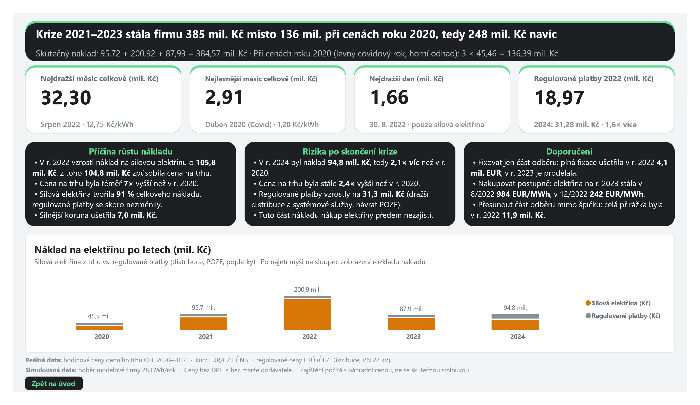
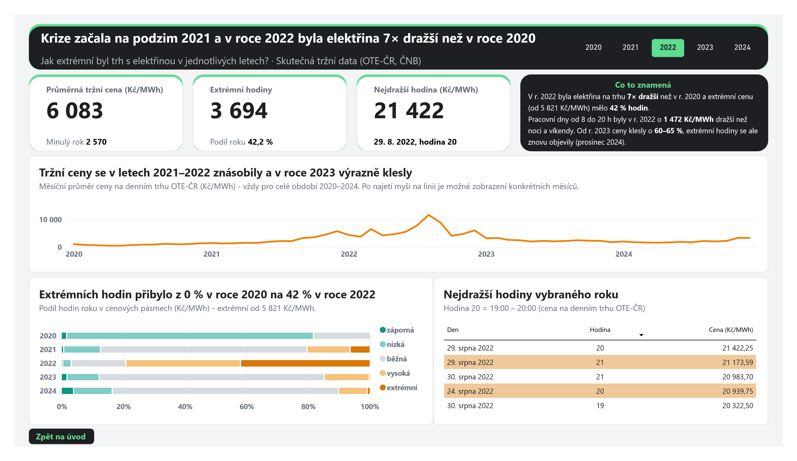
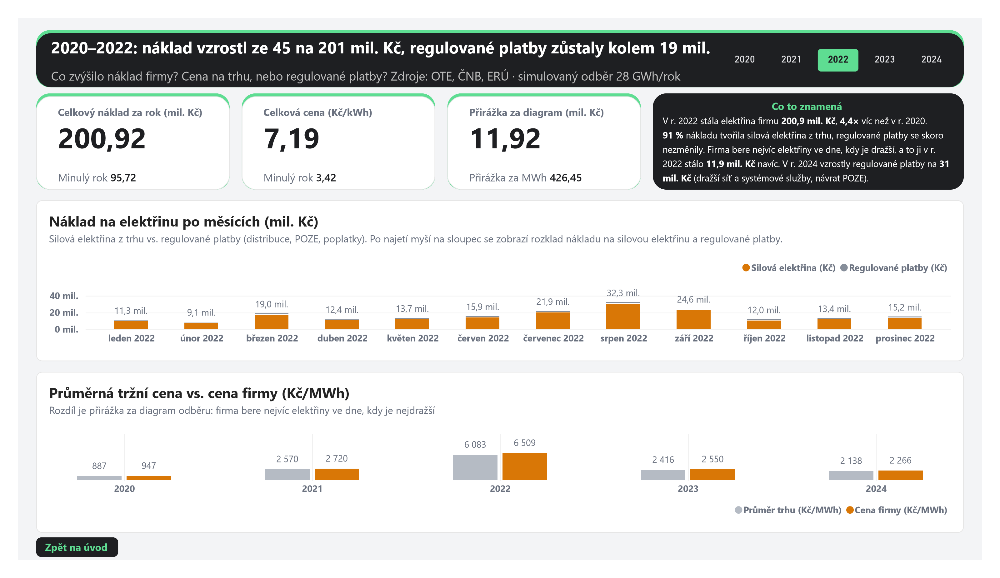
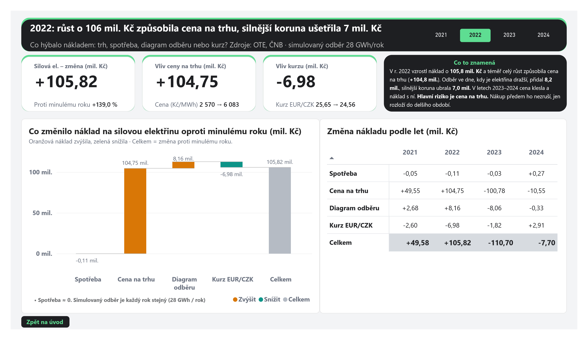
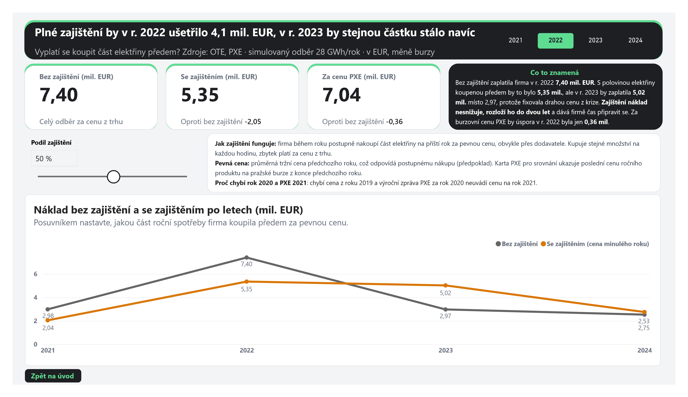
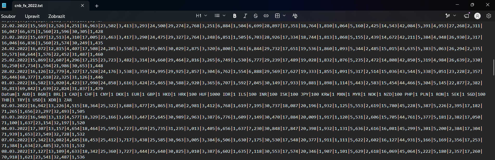
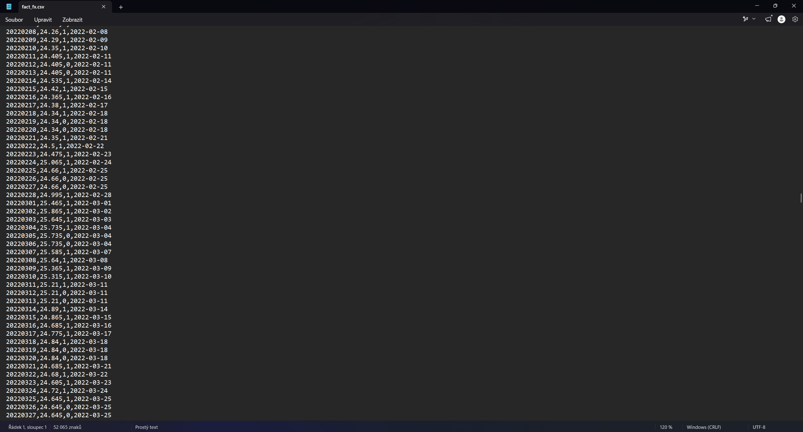
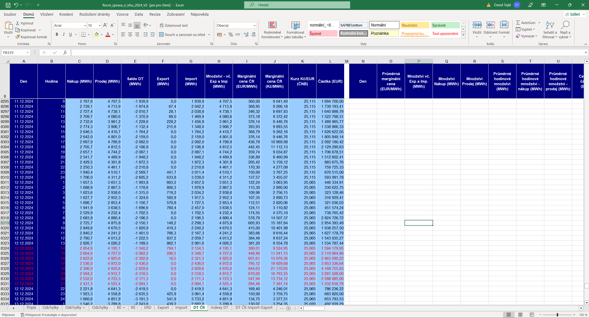
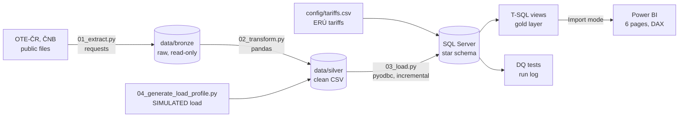

# Energy Crisis Cost Analysis 2021–2023

## What did it cost a Czech industrial company, and could it have protected itself?

**English** · [Čeština](README_cz.md)

[](https://github.com/DavidTejkl/energy-crisis-cost-analysis/actions/workflows/pipeline-check.yml)

`Python (pandas, requests, pyodbc)` · `SQL Server / T-SQL` · `star schema` · `Power BI (DAX, what-if)` · `data quality tests` · `GitHub Actions` · `REST API (JSON)`

Author: David Tejkl · [About me](#about-me) · [LinkedIn](https://www.linkedin.com/in/david-tejkl)

**The 2021–2023 energy crisis cost a model Czech industrial company 385 m CZK for electricity. That is 248 m CZK more than if it had paid 2020 prices. Almost all of the increase came from the market price of electricity. If the company had always bought its whole consumption a year ahead at a fixed price, it would have saved in 2022, but lost the same amount in 2023.**

The energy crisis was a big topic for Czech industrial companies, and I wanted to use it to try a complete and detailed data analysis, from downloading the data to a report for management. Today, in 2026, it is easy to say that the crisis ended and prices fell again. But companies had to decide at a time when nobody knew that. In August 2022, electricity for 2023 traded on the PXE exchange at up to 984 EUR/MWh. The average day-ahead price in 2023 then turned out to be 101 EUR/MWh. That is why I calculate buying in advance only with the price the company knew when it made the decision, not with how things turned out in the end.

Electricity prices, exchange rates and regulated charges are real data from 2020–2024. The company's load is simulated (28 GWh a year), because companies do not publish their load curves. I checked every number in the report in SQL.

**Project in numbers:** 43,848 hourly prices · 5 years · 3 public data sources · 7 tables and 6 views in SQL Server · 9 analysis queries · 31 data quality checks · 6 decision records (ADR) · 64 DAX measures · 6 report pages



**How to see the report:**

1. [interactive report](https://app.powerbi.com/view?r=eyJrIjoiYWZjZGQ2NWMtYzYyMS00OGFjLWI0ZmQtOTcyYzM1Mzg2YTU5IiwidCI6ImRjZGU2NWY3LTMxZjctNGRhMC04MWViLTY4MTM1YjE3NjkwNCIsImMiOjl9) (Power BI, no sign-in, available until January 2027)
2. [2-minute video](docs/report/energy_crisis_cost_analysis_demo_1920.mp4)
3. [PDF with all 6 pages](docs/report/energy_crisis_cost_analysis_report_final.pdf)
4. [.pbix file](https://github.com/DavidTejkl/energy-crisis-cost-analysis/releases/latest) (the free Power BI Desktop is enough, the data is inside the file, you do not need the database)

The report is in Czech. The documentation in `docs/` is in English and Czech, the code is in English.

---

## What this project demonstrates

| Skill | Where to find it |
|---|---|
| Business analysis: stakeholders, user stories, MoSCoW, traceability from the question to the report page | [docs/requirements.md](docs/requirements.md), [docs/dashboard_spec.md](docs/dashboard_spec.md) |
| Python ETL: download, cleaning of real files with a changing format, incremental load, one-command pipeline | [python/](python/) |
| Data modelling: star schema with documented grain, keys and constraints | [docs/data_model.md](docs/data_model.md), [sql/02_create_tables.sql](sql/02_create_tables.sql) |
| SQL: CTEs, window functions (LAG, RANK), joins on validity periods, conditional aggregation | [sql/04–12](sql/) |
| Analytical methods: cost change decomposition, exchange rate effect, hedging scenarios (what-if) | [sql/10](sql/10_query_variance_split.sql), [sql/11](sql/11_query_fx_effect.sql), [sql/12](sql/12_query_hedging.sql) |
| Data quality: automated checks, unusual values verified in the source, checksums in CI | [sql/91_dq_tests.sql](sql/91_dq_tests.sql), [docs/data_quality_report.md](docs/data_quality_report.md) |
| Power BI: data model, DAX measures, what-if parameter, page titles that state the conclusion | [powerbi/](powerbi/), [docs/kpi_definitions.md](docs/kpi_definitions.md) |
| Documentation: decision records, KPI definitions, methodology, labelled assumptions | [docs/](docs/) |

## Business questions and answers

The analysis answers the questions a CFO and the energy purchasing manager deal with when they plan the budget and decide how much electricity to buy in advance ([brief](docs/01_project_brief.md), [requirements](docs/requirements.md)). The numbers are for 2022, when the crisis was at its worst.

| Question | Answer | Query |
|---|---|---|
| **1. What did electricity really cost per kWh?** | **7.19 CZK/kWh** all-in (power, distribution, system services, POZE and tax, without VAT). In 2020 it was **1.62 CZK/kWh**, 4.4 times less. Power from the market made up 91 % of the bill. | [`sql/08`](sql/08_query_allin_price.sql) |
| **2. Why did the cost change?** | The power cost rose by **105.82 m CZK**. The market price added **104.75 m CZK**, the daily load profile 8.16 m CZK, the stronger koruna took off 6.98 m CZK and a slightly lower consumption 0.11 m CZK. | [`sql/10`](sql/10_query_variance_split.sql) |
| **3. How did the EUR/CZK rate affect the cost in CZK?** | The koruna strengthened and that **saved the company 6.98 m CZK**. I use the cost-weighted rate, which fell from 25.53 to 24.59 CZK/EUR ([why weighted](docs/decisions/ADR-006-fx-effect-split.md)). | [`sql/11`](sql/11_query_fx_effect.sql) |
| **4. Could the loss have been prevented by hedging?** | Not by buying the whole consumption a year ahead. At the prior-year average price the company would have **saved 4.10 m EUR in 2022, but paid 4.10 m EUR extra in 2023**. With the real PXE year-end prices, a full hedge would have cost **3.62 m EUR more** than buying on spot over 2022–2024. | [`sql/12`](sql/12_query_hedging.sql) |

## The business problem

The company is fictional. It is an energy-intensive manufacturer with an operation that runs 24 hours a day all year. From Sunday 22:00 to Friday 22:00 shift work is added to it, and offices on weekday mornings. The company uses about 28 GWh a year and is connected to the ČEZ Distribuce grid at high voltage (22 kV). It buys all its electricity at day-ahead (spot) prices, so I calculate the worst case.

The analysis would be read by the CFO, who is responsible for the budget, and the energy manager, who decides what part of next year's consumption to buy in advance at a fixed price.

Throughout the project I distinguish what is a fact from a source or a query (`FACT`), what is an assumption (`ASSUMPTION`), what is simulated (`SIMULATED`), what is a finding (`FINDING`) and what is a recommendation (`RECOMMENDATION`).

## The report

The report has six pages: About the project, Summary and four detail pages. I compared every number in the report with the results of the SQL queries in [sql/](sql/). How I designed the pages and why is in the [report specification](docs/dashboard_spec.md).

| | |
|---|---|
|  **Market:** prices 7 times higher in 2022, 42 % of hours extreme |  **Company cost:** growth from 45 to 201 m CZK in 2020–2022, regulated charges unchanged |
|  **Why it changed:** waterfall of market price, load profile, consumption and exchange rate |  **Hedging:** slider for 0–100 % of the load bought in advance |

## Key findings

The findings are based on real OTE, ČNB and ERÚ data and on the simulated load of the model company. All findings, with the query behind every number, are in [docs/findings.md](docs/findings.md).

### 1. The electricity bill rose 4.4 times, the market price almost 7 times

| | 2020 | 2021 | 2022 | 2023 | 2024 |
|---|---:|---:|---:|---:|---:|
| Average market price (CZK/MWh) | 887 | 2,570 | **6,083** | 2,416 | 2,138 |
| Total electricity cost (m CZK) | 45.5 | 95.7 | **200.9** | 87.9 | 94.8 |
| of which regulated charges (m CZK) | 18.9 | 19.6 | 19.0 | 16.7 | 31.3 |
| All-in price (CZK/kWh) | 1.62 | 3.42 | **7.19** | 3.15 | 3.38 |
| Power share of the bill | 58 % | 80 % | 91 % | 81 % | 67 % |

The company used almost the same amount of electricity every year (27.95–28.05 GWh), and yet its bill rose 4.4 times between 2020 and 2022. Power got more expensive in step with the market, almost 7 times. Regulated charges (distribution, system services, POZE and tax) stayed around 19 m CZK, because they are set by ERÚ and by law. In 2020 they made up 42 % of the bill, which is why the whole bill rose less than the market price: 0.58 × 6.9 + 0.42 × 1.0 = 4.4.

After the crisis it turned around. Power got cheaper in 2024, but regulated charges jumped to 31.3 m CZK. The state ended almost all the subsidies from which it had paid POZE during the crisis and kept the price of system services and network losses low. That is why electricity was more expensive in 2024 than in 2023 (3.38 vs 3.15 CZK/kWh). The breakdown by item is in the [findings](docs/findings.md#why-regulated-charges-jumped-in-2024). (`sql/08`)

### 2. Daytime load cost the company an extra 11.9 m CZK in 2022, and buying in advance does not solve it

| | 2020 | 2022 | 2024 |
|---|---:|---:|---:|
| Average market price (CZK/MWh) | 887 | 6,083 | 2,138 |
| Price the company paid (CZK/MWh) | 947 | 6,509 | 2,266 |
| Load profile premium (CZK/MWh) | 60 | 426 | 128 |
| Premium for the whole year (m CZK) | 1.68 | **11.92** | 3.58 |

The company runs non-stop, but during the day shifts and offices are added, exactly in the hours when electricity is most expensive. That is why it pays more than the average market price, and I call this difference the load profile premium. In 2022 this premium cost the company 7 times more than in 2020, although its consumption stayed the same. The gap between expensive and cheap hours grew with the price: weekdays from 8:00 to 20:00 were 330 CZK/MWh more expensive than the rest of the week in 2020, and 1,472 CZK/MWh in 2022.

Buying in advance does not remove the premium. A yearly contract (base load) delivers the same amount in every hour, so the company buys the missing daytime power on spot at high prices and sells the night surplus cheaply, whatever price it paid for the contract. Even with its whole consumption bought in advance it would have paid the full premium in 2022 (483,333 EUR, I calculate hedging in euros). This part of the cost, however, the company can influence itself by moving part of its load to nights and weekends. The yearly premium is the upper limit of what it could save that way. (`sql/09`, `sql/10`, `sql/12`)

### 3. Buying a year ahead: a saving in 2022, an equally large loss in 2023

| Delivery year | Spot cost (thousand EUR) | Difference at price = prior-year average (thousand EUR) | Difference at the PXE price from the end of the prior year (thousand EUR) |
|---|---:|---:|---:|
| 2021 | 2,982 | −1,877 | not available |
| 2022 | 7,400 | **−4,103** | −714 |
| 2023 | 2,972 | **+4,099** | +3,946 |
| 2024 | 2,530 | +440 | +391 |
| 2022–2024 | 12,902 | +436 | **+3,623** |

A negative number is a saving against spot. Both differences assume that the company buys its whole yearly consumption in advance at one fixed price. The prior-year average is my substitute price (`ASSUMPTION`), because OTE does not publish forward prices. The PXE price is the real price of the yearly product in the last trade of the year. The PXE annual report does not give it for 2021.

The company would have gone through the crisis anyway, just a year later. Without a hedge it paid 7.40 m EUR in 2022. With a full hedge it would have paid 7.07 m EUR in 2023, because it would have bought the electricity for 2023 still at crisis prices. The day of purchase also matters a lot. Electricity for 2023 cost **123.88 EUR/MWh** on the PXE exchange on the first trading day of 2022, **984.00 EUR/MWh** on 26 Aug 2022 and **241.98 EUR/MWh** in the last trade of the year on 28 Dec 2022.

Recommendation (`RECOMMENDATION`): do not buy the whole consumption at once, but in parts during the whole year before delivery, and leave a part on spot. Then the price is not decided by one day when the market happened to be high. I did not calculate such gradual buying, because daily PXE prices are not freely downloadable. (`sql/12`)

### 4. The most expensive day cost the company 22.8 times more than an average day of 2020

For every year the table shows the day on which the company paid the most for power. Without regulated charges, the whole load on spot, the load is `SIMULATED`.

| Year | Most expensive day | Load (MWh) | Power cost (CZK) | Weighted price (CZK/MWh) | × average day of 2020 |
|---|---|---:|---:|---:|---:|
| 2020 | Wed 9 Dec 2020 | 78.8 | 186,946 | 2,374 | 2.6 |
| 2021 | Tue 21 Dec 2021 | 78.6 | 912,097 | 11,609 | 12.6 |
| 2022 | **Tue 30 Aug 2022** | 97.8 | **1,657,483** | 16,949 | **22.8** |
| 2023 | Mon 23 Jan 2023 | 78.5 | 406,854 | 5,182 | 5.6 |
| 2024 | Thu 12 Dec 2024 | 78.5 | 830,802 | 10,579 | 11.5 |

An average day cost 72,545 CZK in 2020 and 498,512 CZK in 2022. The company's most expensive day was not the market's most expensive day. The market peaked on Friday 26 Aug 2022, but the company paid more on Tuesday 30 Aug (1,657,483 vs 1,629,833 CZK), because shift work ends on Friday at 22:00 and the company used less (93.8 vs 97.8 MWh). A company with a fixed price would not have paid such daily amounts, this is the worst case. ([details](docs/findings.md#most-expensive-day-for-the-company))

### 5. What remained after the crisis

- Regulated charges stayed high. In 2024 they were 31.3 m CZK, 1.6 times more than in 2022, and buying electricity in advance does not protect against them at all. (`sql/08`)
- Price spikes are coming back. The most expensive hour of 2024 (12 Dec 2024, 17:00–18:00, 21,171 CZK/MWh) was almost as expensive as the peak of the crisis (29 Aug 2022, 19:00–20:00, 21,422 CZK/MWh). I explain why in the [Data quality](#data-quality) section. (`sql/07`)
- The state cap of 5,000 CZK/MWh applied in 2023, when prices had already fallen. The company's monthly power price in 2023 was at most 3,572 CZK/MWh (January), so the cap never reached it. In 2022, when there was no cap yet, it was above this limit in six months. (`sql/08`)

## How I checked the numbers

I did not want a single number in the report that I was not sure about. This is how I checked them:

- I went through all 6 report pages. On the pages with a year selector I clicked through every year, I set the hedging slider to 0, 50 and 100 %, and I compared every card, label and table with the result of a SQL query. The 2022 total cost came out as 200,924,897.61 CZK in the view, in query 08 and in the report.
- A split must add up to the whole. When I split the cost change into consumption, market price and load profile, the sum differs from the total change by at most 0.03 EUR. For the split into price and exchange rate it is at most 2.05 CZK. The difference comes from rounding in the division.
- For every query I check the row count first. One of my first queries taught me that: in the daily overview I put the expression `volume * price` into GROUP BY instead of a sum, and instead of 1,827 days I got 43,809 rows.
- I calculate prices as a weighted average, the whole cost divided by the whole load. A simple average of the hourly prices would give 6,083 CZK/MWh in 2022 instead of the real 6,509 CZK/MWh, because the company takes the most electricity in the more expensive hours.
- The whole process can be repeated from scratch. GitHub Actions downloads the raw data on a clean Windows machine, cleans it and compares the SHA-256 checksums with the ones stored in the repository. The first run failed because the Windows console on GitHub could not print the letter "Č". I built the project on two computers and the database came out the same on both, I checked it with a checksum of every table.
- I also checked the exchange rates another way, through the ČNB REST API, on 6 days where a mistake is most likely (details in How to run).

## Data

| Source | What | Granularity | Period |
|---|---|---|---|
| [OTE-ČR](https://www.ote-cr.cz/cs/statistika/rocni-zprava) yearly market report (V2, final settlement) | day-ahead price EUR/MWh, volume MWh | hour | 2020–2024 |
| [ČNB](https://www.cnb.cz/cs/financni-trhy/devizovy-trh/kurzy-devizoveho-trhu/) exchange rates | EUR/CZK | ČNB working days | 2019–2024 |
| ERÚ price decisions and Act 261/2007 | distribution, system services, POZE, OTE fees and electricity tax with their validity periods ([config/tariffs.csv](config/tariffs.csv), 41 rows) | validity period | 2020–2024 |
| PXE annual reports | year-end price of the CZ base load yearly product, to compare hedging ([prices and sources](docs/decisions/ADR-003-forward-price-proxy.md)) | year | 2022–2024 |
| [ČNB](https://www.cnb.cz/cs/casto-kladene-dotazy/.galleries/vyvoj_repo_historie.txt) 2-week repo rate | monetary policy rate (context only, see Limits) | validity period | 2019–2024 |
| Own generator | hourly load of the model company, `SIMULATED` ([methodology](docs/methodology.md)) | hour | 2020–2024 |

The data is not in the repository, the scripts download it.

## Data cleaning

The raw files stay unchanged in `data/bronze`, all cleaning is done by script into `data/silver`. I only flag problem rows, nothing is deleted silently.

| Raw ČNB file 2022 (bronze) | Cleaned exchange rates (silver) |
|---|---|
|  |  |
| On 2 Mar 2022 the file repeats its header, the rouble column disappears and all the following columns shift. | I select EUR by column name and skip the repeated header. Every calendar day has one row: weekends get the rate of the last working day with the flag `is_actual_rate = 0` and the date `source_date` ([why like this](docs/decisions/ADR-001-eur-czk-fill-rule.md)). |

Other rules in [python/02_transform.py](python/02_transform.py):

- Days with a clock change have 23 or 25 hours in the OTE data. 1,827 days × 24 = 43,848 rows only because the missing spring hour and the extra autumn hour cancel out. That is why the check counts hours per day, not rows per year.
- OTE publishes 2020–2023 as `.xls` and 2024 as `.xlsx`, one column exists only from 2021 and the 2024 headers have line breaks. That is why I select columns by their normalised name, never by position.

## Data quality

The data is guarded by 31 checks in [sql/91_dq_tests.sql](sql/91_dq_tests.sql). They check that no day, hour or price is missing, that the days with 23 and 25 hours fall on the last Sunday of March and October, that nothing is in the data twice, that prices and rates are in a sensible range and that weekends and holidays have the rate of the last working day. I also recompute in SQL the calendar columns that Python calculated, and compare them.

18 of them write their result into the `dq_results` table on every run. The latest run ended with 17 PASS and 1 WARN. The warning reports 609 hours with a negative price, which are real, so I keep them in the data. The other checks print overviews, for example the five most expensive hours of every year. Results: [docs/data_quality_report.md](docs/data_quality_report.md).

In the list of the most expensive hours I noticed, during the first check, 12 Dec 2024 between 17:00 and 18:00: **844.63 EUR/MWh**. In the same hour it was 199.29 EUR/MWh on 10 Dec and 442.45 EUR/MWh on 11 Dec, so I first looked for an error. I opened the raw OTE file in Excel and the value was the same there. The CZK price that OTE gives in the file also agrees (844.63 × 25.065 = 21,170.65 CZK/MWh). The price also did not jump in a single hour, it rose and fell smoothly over the whole evening, which a typo would not do. The cause: in the same hour Germany was at the peak of a Dunkelflaute, cold days with almost no wind and sun, and the day-ahead price there reached 936 EUR/MWh ([article on the Dunkelflaute](https://www.cleanenergywire.org/news/short-term-power-prices-spike-amid-new-dunkelflaute-germany-most-customers-unaffected)). The Czech and German markets are coupled, which explains the price. I kept it in the data.



## Architecture



- The data is in a star schema ([data model](docs/data_model.md)). OTE prices and the simulated load have one row per hour, ČNB rates one row per day, and they are linked by shared calendar and hour dimensions. I store regulated prices and the repo rate as validity periods. I wrote down the grain of every table, what one row means, before I loaded any data into it.
- Power BI reads the data from views in SQL Server, that is my gold layer. Costs and MWh in them can be summed over any period. I never sum prices, I calculate them as a ratio of sums.
- In the Power BI model the dimensions are linked to the facts one-to-many and in one direction, and several fact tables share the same dimensions (galaxy schema). I turned off auto date/time and marked `dim_date` as the date table. All 64 DAX measures are written down with their formula and a check value ([DAX measures](docs/kpi_definitions.md#dax-measures-in-power-bi)).
- I run the whole pipeline with one command. The load is incremental: the script finds the highest key already loaded and loads only newer rows, so a second run inserts nothing. Every run is logged in the `etl_run_log` table ([sql/90_etl_infrastructure.sql](sql/90_etl_infrastructure.sql)). [GitHub Actions](.github/workflows/pipeline-check.yml) also checks the Python part on every code change, the SQL Server part runs only locally on my computer.
- The report is saved as PBIP, which means as text files, so every change of a visual or a measure is visible in the git history.

### Key decisions

I wrote the decisions that affect the resulting numbers into short records (ADR). Each one says why a decision was needed, which options I considered, what I chose and what follows from it.

| Decision | Why |
|---|---|
| [Weekend and holiday rate = last ČNB rate, flagged](docs/decisions/ADR-001-eur-czk-fill-rule.md) | ČNB publishes rates on working days only |
| [Hedging price = prior-year average spot price, PXE year-end prices for comparison](docs/decisions/ADR-003-forward-price-proxy.md) | OTE does not publish forward prices, and the substitute price uses only data the company knew at that moment |
| [Cost change split into consumption, market price and load profile](docs/decisions/ADR-004-cost-variance-split.md) | the three effects add up exactly to the total change |
| [What the all-in price includes: ČEZ Distribuce, VN, without VAT and supplier margin, 2023 cap](docs/decisions/ADR-005-all-in-price-scope.md) | regulated prices differ by distribution area and voltage level |
| [Exchange rate effect through the cost-weighted rate](docs/decisions/ADR-006-fx-effect-split.md) | a simple yearly average rate does not give the real cost in CZK, days with a high cost must have a bigger weight |

## How to run

<details>
<summary>Requirements and commands (Windows)</summary>

Requirements: Windows, Python 3.13, SQL Server (local default instance, Windows authentication), ODBC Driver 17 for SQL Server, `sqlcmd` and, for the report, the free Power BI Desktop.

```bash
# 1. Python environment
py -m venv .venv
source .venv/Scripts/activate    # Git Bash, in PowerShell: .venv\Scripts\Activate.ps1
pip install -r requirements.txt

# Steps 2–4 in one command (stops at the first failing step, the second run is incremental):
# py python/run_pipeline.py

# 2. Download and clean the data
py python/01_extract.py          # raw files into data/bronze (skips files already downloaded)
py python/02_transform.py        # cleaned CSV files into data/silver
py python/04_generate_load_profile.py   # SIMULATED hourly load of the model company into data/silver

# 3. Database and load
sqlcmd -S localhost -E -C -b -f 65001 -i sql/01_create_database.sql
sqlcmd -S localhost -E -C -b -f 65001 -i sql/02_create_tables.sql
sqlcmd -S localhost -E -C -b -f 65001 -i sql/90_etl_infrastructure.sql   # run log and check result tables (kept on rebuild)
py python/03_load.py             # inserts only rows newer than the table holds and logs the run

# 4. Views, data quality checks and analysis
sqlcmd -S localhost -E -C -b -f 65001 -i sql/03_create_views.sql
sqlcmd -S localhost -E -C -b -f 65001 -i sql/91_dq_tests.sql
sqlcmd -S localhost -E -C -b -f 65001 -i sql/08_query_allin_price.sql     # queries 04–12 run the same way

# 5. Optional: check the exchange rates against the ČNB REST API (needs internet)
py python/05_check_fx_api.py     # 6 edge-case days, prints OK / DIFFERENCE for each

# 6. Report: open powerbi/energy_crisis_cost_analysis_report.pbip in Power BI Desktop and click Refresh
```

Expected row counts after the load: `dim_date` 1,827 · `dim_hour` 25 · `repo_rate` 22 · `regulated_price` 41 · `fact_energy_prices` 43,848 · `fact_fx` 1,827 · `fact_load` 43,848.

</details>

<details>
<summary>Checking the exchange rates against the ČNB REST API</summary>

The pipeline downloads one text file per year from ČNB. As a check, the script [python/05_check_fx_api.py](python/05_check_fx_api.py) asks the ČNB REST API (JSON) for 6 edge-case days and compares both the rate and the date the rate comes from with the cleaned data:

```
Silver EUR/CZK vs ČNB REST API:
  2020-01-01: silver 25.41 from 2019-12-31 | API 25.41 from 2019-12-31 -> OK
  2020-01-02: silver 25.41 from 2020-01-02 | API 25.41 from 2020-01-02 -> OK
  2022-03-02: silver 25.865 from 2022-03-02 | API 25.865 from 2022-03-02 -> OK
  2022-03-05: silver 25.735 from 2022-03-04 | API 25.735 from 2022-03-04 -> OK
  2020-03-16: silver 26.96 from 2020-03-16 | API 26.96 from 2020-03-16 -> OK
  2024-12-31: silver 25.185 from 2024-12-31 | API 25.185 from 2024-12-31 -> OK
6 of 6 days match.
```

I chose a public holiday filled from the last rate of 2019, a normal working day, 2 Mar 2022 with the repeated header, a Saturday, the largest daily jump of the rate and the last day. [The API answer for Saturday 5 Mar 2022](https://api.cnb.cz/cnbapi/exrates/daily?date=2022-03-05&lang=EN) returns the Friday rate (`"validFor": "2022-03-04"`), exactly the one the pipeline fills in for the Saturday. To know that the check really finds an error, I changed one rate by 0.01 CZK on purpose and the script reported `DIFFERENCE`. The API is only a check, because for the whole period it would need 1,827 requests, the yearly files only 6.

</details>

### Repository map

```
python/    01_extract · 02_transform · 03_load · 04_generate_load_profile · 05_check_fx_api · run_pipeline · config.py
sql/       01–03 database, tables, views · 04–12 analysis queries · 90 pipeline log tables · 91 data quality tests
powerbi/   Power BI report as PBIP (model in TMDL, pages in JSON) and colour theme
config/    regulated price components with validity periods (ERÚ, 2020–2024)
docs/      brief, requirements, report specification, data model, KPI and DAX definitions, methodology of the simulated
           load, data quality report, findings, decisions (ADRs), report PDF, video and screenshots
tests/     SHA-256 checksums of the cleaned data (used by GitHub Actions)
data/      bronze (raw) and silver (cleaned), created by the scripts, not in git
```

## Limits

- **Simulated load.** One model company with 28 GWh a year and the same weekly pattern. The consumption effect therefore comes out almost zero, and the findings about the load profile reflect the generator's settings, not a real operation.
- **Worst case on power.** The company buys everything at spot prices. Real companies often fix their price in advance. In a [survey by the Confederation of Industry of the Czech Republic](https://www.spcr.cz/drahe-energie-na-firmy-dopadnou-zejmena-v-pristim-roce) from September 2022 (114 mostly industrial companies), almost two thirds had a fixed electricity price for 2022, for 2023 only 20 %.
- **Hedging with a substitute price.** OTE does not publish forward prices. The hedging price is the prior-year average spot price (`ASSUMPTION`), the PXE year-end prices are taken from the annual reports. Buying in parts during the year is not calculated.
- **All-in price scope.** Without VAT, supplier margin and the small ERÚ activity fee. Reserved capacity of 5 MW is an assumption, and the distribution prices apply only to ČEZ Distribuce at high voltage.
- **Public holidays.** Public holidays on weekdays count as peak hours, the calendar has no holiday flag yet.
- **Repo rate.** I loaded the ČNB repo rate as context ([why not PRIBOR](docs/decisions/ADR-002-interest-rate-source.md)), but I do not use it in the analysis or the report yet.
- **Local database.** SQL Server runs locally, GitHub Actions checks only the Python part. The link to the interactive report works until January 2027, the PDF, video, screenshots and the `.pbix` file stay.

With real company data the same pipeline would load metered 15-minute consumption instead of the simulated load, the supplier's contract terms instead of 100 % spot, and a plan of buying in parts instead of a one-off hedge.

## About me

My name is David Tejkl. I have worked in industry for 15 years, and since 2022 I have been doing requirements analysis for changes of production control systems and internal applications. I collect requirements from operators, write specifications for external programmers and test finished changes. In alarm and signal histories (AVEVA InTouch, Siemens S7) I analyse fault data and logs. I also work with SAP data on electrical inspections, planned maintenance and regular equipment checks. I match them by equipment with the faults from the InTouch alarm history and check whether faults drop after a check. This shows me which equipment keeps failing despite regular checks and gives me a basis for adjusting maintenance intervals. I have worked with operational data for years, and in this project I tried the whole path from raw data to a report.

Also take a look at my second project, the [change request process analysis](https://github.com/DavidTejkl/bpmn-change-request-process-analysis) (BPMN, specification, UAT).

[GitHub profile](https://github.com/DavidTejkl) · [LinkedIn](https://www.linkedin.com/in/david-tejkl)
