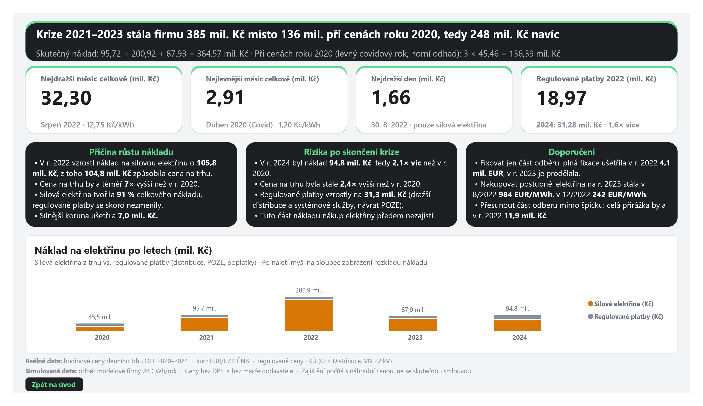
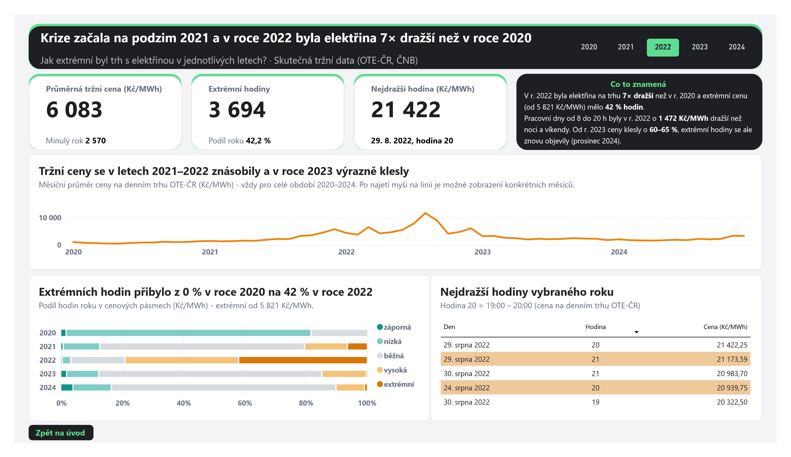
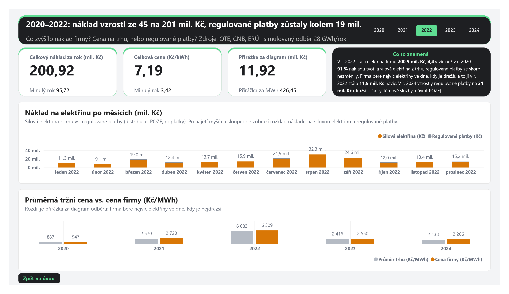
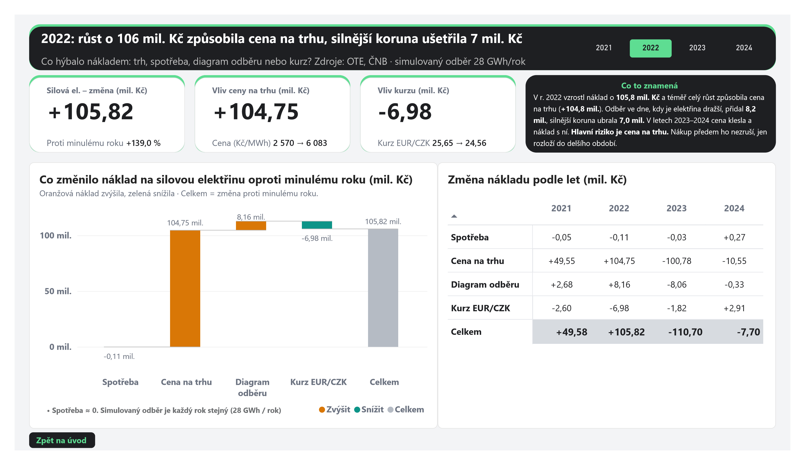
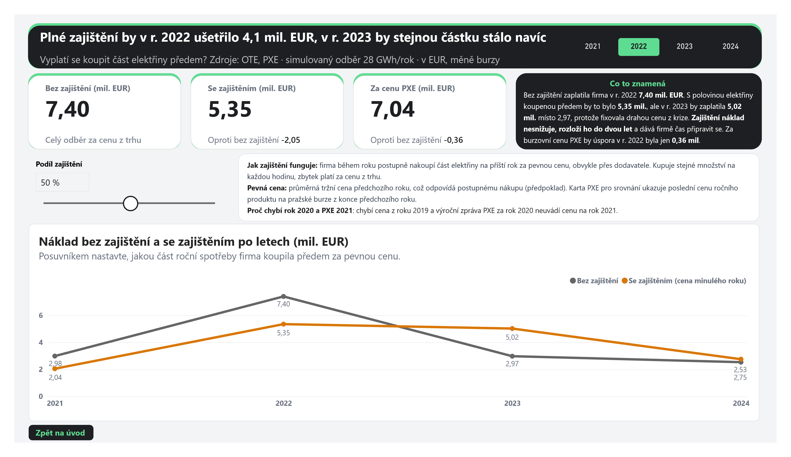
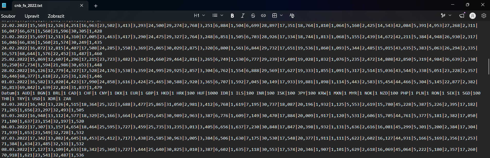
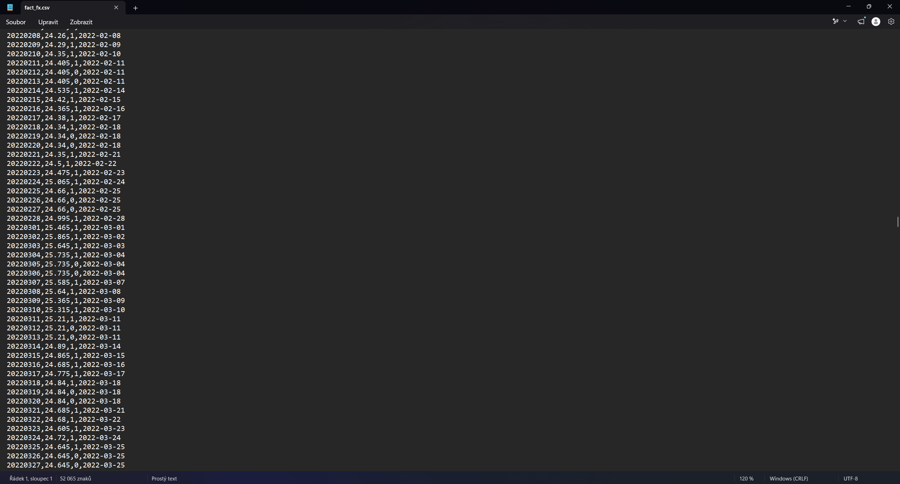
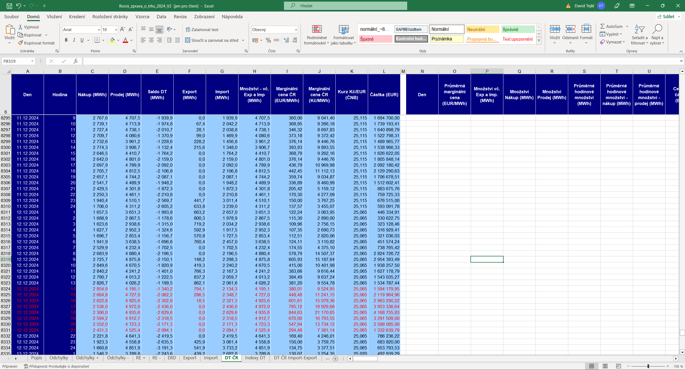
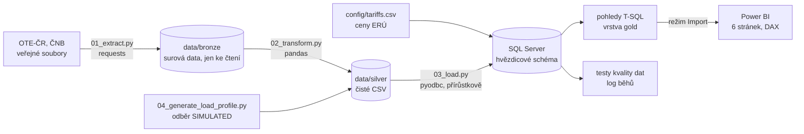

# Analýza nákladů energetické krize 2021–2023

## Kolik stála českou průmyslovou firmu a dalo se jí bránit?

[English](README.md) · **Čeština**

[](https://github.com/DavidTejkl/energy-crisis-cost-analysis/actions/workflows/pipeline-check.yml)

`Python (pandas, requests, pyodbc)` · `SQL Server / T-SQL` · `hvězdicové schéma` · `Power BI (DAX, what-if)` · `testy kvality dat` · `GitHub Actions` · `REST API (JSON)`

Autor: David Tejkl · [O mně](#o-mně) · [LinkedIn](https://www.linkedin.com/in/david-tejkl)

**Energetická krize 2021–2023 stála modelovou českou průmyslovou firmu 385 mil. Kč za elektřinu. To je o 248 mil. Kč víc, než kdyby platila ceny z roku 2020. Skoro celé zdražení způsobila cena elektřiny na trhu. Kdyby firma kupovala celou spotřebu vždy rok dopředu za pevnou cenu, v roce 2022 by ušetřila, ale v roce 2023 by stejnou částku prodělala.**

Energetická krize byla pro české průmyslové firmy velké téma a chtěl jsem si na ní vyzkoušet kompletní a detailní datovou analýzu, od stažení dat až po report pro vedení firmy. Dnes, v roce 2026, je snadné říct, že krize skončila a ceny zase klesly. Firmy se ale musely rozhodovat v době, kdy to nikdo nevěděl. V srpnu 2022 se elektřina na rok 2023 obchodovala na burze PXE až za 984 EUR/MWh. Průměrná cena na denním trhu v roce 2023 pak byla 101 EUR/MWh. Proto nákup dopředu počítám jen s cenou, kterou firma v době rozhodnutí znala, a ne s tím, jak to nakonec dopadlo.

Ceny elektřiny, kurzy a regulované poplatky jsou skutečná data z let 2020–2024. Odběr firmy je simulovaný (28 GWh za rok), protože firmy svoje odběrové diagramy nezveřejňují. Každé číslo v reportu jsem si ověřil v SQL.

**Projekt v číslech:** 43 848 hodinových cen · 5 let · 3 veřejné zdroje dat · 7 tabulek a 6 pohledů v SQL Serveru · 9 analytických dotazů · 31 kontrol kvality dat · 6 záznamů o rozhodnutí (ADR) · 64 měr DAX · 6 stránek reportu



**Jak si report prohlédnout:**

1. [interaktivní report](https://app.powerbi.com/view?r=eyJrIjoiYWZjZGQ2NWMtYzYyMS00OGFjLWI0ZmQtOTcyYzM1Mzg2YTU5IiwidCI6ImRjZGU2NWY3LTMxZjctNGRhMC04MWViLTY4MTM1YjE3NjkwNCIsImMiOjl9) (Power BI, bez přihlášení, dostupný do ledna 2027)
2. [dvouminutové video](docs/report/energy_crisis_cost_analysis_demo_1920.mp4)
3. [PDF se všemi 6 stránkami](docs/report/energy_crisis_cost_analysis_report_final.pdf)
4. [soubor .pbix](https://github.com/DavidTejkl/energy-crisis-cost-analysis/releases/latest) (stačí bezplatný Power BI Desktop, data jsou přímo v souboru, databázi nepotřebujete)

Report je v češtině. Dokumentace ve složce `docs/` je česky i anglicky, kód je anglicky.

---

## Co projekt ukazuje

| Dovednost                                                                                                              | Kde ji najdete                                                                                                      |
| ---------------------------------------------------------------------------------------------------------------------- | ------------------------------------------------------------------------------------------------------------------- |
| Business analýza: stakeholdeři, user stories, MoSCoW, návaznost od otázky po stránku reportu                           | [docs/requirements_cz.md](docs/requirements_cz.md), [docs/dashboard_spec_cz.md](docs/dashboard_spec_cz.md)          |
| ETL v Pythonu: stažení, čištění reálných souborů s měnícím se formátem, přírůstkové načítání, pipeline na jeden příkaz | [python/](python/)                                                                                                  |
| Datové modelování: hvězdicové schéma s popsanou granularitou, klíči a omezeními                                        | [docs/data_model_cz.md](docs/data_model_cz.md), [sql/02_create_tables.sql](sql/02_create_tables.sql)                |
| SQL: CTE, okenní funkce (LAG, RANK), spojení podle období platnosti, podmíněná agregace                                | [sql/04–12](sql/)                                                                                                   |
| Analytické metody: rozklad změny nákladu, vliv kurzu, scénáře zajištění (what-if)                                      | [sql/10](sql/10_query_variance_split.sql), [sql/11](sql/11_query_fx_effect.sql), [sql/12](sql/12_query_hedging.sql) |
| Kvalita dat: automatické kontroly, neobvyklé hodnoty ověřené ve zdroji, kontrolní součty v CI                          | [sql/91_dq_tests.sql](sql/91_dq_tests.sql), [docs/data_quality_report_cz.md](docs/data_quality_report_cz.md)        |
| Power BI: datový model, míry DAX, parametr what-if, nadpisy stránek, které říkají závěr                                | [powerbi/](powerbi/), [docs/kpi_definitions_cz.md](docs/kpi_definitions_cz.md)                                      |
| Dokumentace: záznamy o rozhodnutích, definice KPI, metodika, označené předpoklady                                      | [docs/](docs/)                                                                                                      |

## Obchodní otázky a výsledky

Analýza odpovídá na otázky, které ve firmě řeší finanční ředitel a nákup energií (energetik), když plánují rozpočet a rozhodují, kolik elektřiny koupit předem ([zadání](docs/01_project_brief_cz.md), [požadavky](docs/requirements_cz.md)). Čísla jsou za rok 2022, kdy byla krize nejhorší.

| Otázka                                              | Odpověď                                                                                                                                                                                                                                                                                                       | Dotaz                                       |
| --------------------------------------------------- | ------------------------------------------------------------------------------------------------------------------------------------------------------------------------------------------------------------------------------------------------------------------------------------------------------------- | ------------------------------------------- |
| **1. Kolik elektřina skutečně stála za kWh?**       | **7,19 Kč/kWh** se vším všudy (silová elektřina, distribuce, systémové služby, POZE a daň, bez DPH). V roce 2020 to bylo **1,62 Kč/kWh**, tedy 4,4× méně. Silová elektřina z trhu tvořila 91 % účtu.                                                                                                          | [`sql/08`](sql/08_query_allin_price.sql)    |
| **2. Proč se náklad změnil?**                       | Náklad na silovou elektřinu vzrostl o **105,82 mil. Kč**. Cena na trhu ho zvýšila o **104,75 mil. Kč**, denní diagram odběru o 8,16 mil. Kč, silnější koruna ho snížila o 6,98 mil. Kč a o něco nižší spotřeba o 0,11 mil. Kč.                                                                                | [`sql/10`](sql/10_query_variance_split.sql) |
| **3. Jak náklad v korunách ovlivnil kurz EUR/CZK?** | Koruna posílila a firma díky tomu **ušetřila 6,98 mil. Kč**. Počítám s kurzem váženým náklady, ten klesl z 25,53 na 24,59 Kč/EUR ([proč vážený](docs/decisions/ADR-006-fx-effect-split_cz.md)).                                                                                                               | [`sql/11`](sql/11_query_fx_effect.sql)      |
| **4. Dalo se ztrátě předejít zajištěním?**          | Nákupem celé spotřeby rok dopředu ne. Za průměrnou cenu předchozího roku by firma **v roce 2022 ušetřila 4,10 mil. EUR, ale v roce 2023 by zaplatila 4,10 mil. EUR navíc**. Se skutečnými cenami burzy PXE z konce roku by plné zajištění za roky 2022–2024 stálo **o 3,62 mil. EUR víc** než nákup na spotu. | [`sql/12`](sql/12_query_hedging.sql)        |

## Obchodní problém

Firma je vymyšlená. Je to energeticky náročný výrobce s provozem, který běží 24 hodin denně celý rok. Od neděle 22:00 do pátku 22:00 k němu přibývá směnový provoz a v pracovní dny ráno kanceláře. Firma spotřebuje zhruba 28 GWh za rok a je připojená k síti ČEZ Distribuce na vysokém napětí (22 kV). Všechnu elektřinu kupuje za ceny denního trhu (spot), takže počítám s nejhorším případem.

Analýzu by četli finanční ředitel, který odpovídá za rozpočet, a energetik, který rozhoduje, jakou část spotřeby na příští rok koupit předem za pevnou cenu.

V celém projektu rozlišuju, co je fakt ze zdroje nebo z dotazu (`FACT`), co je předpoklad (`ASSUMPTION`), co je simulované (`SIMULATED`), co je zjištění (`FINDING`) a co doporučení (`RECOMMENDATION`).

## Report

Report má šest stránek: O projektu, Shrnutí a čtyři podrobné stránky. Všechna čísla v reportu jsem porovnal s výsledky SQL dotazů ze složky [sql/](sql/). Jak jsem stránky navrhoval a proč, je ve [specifikaci reportu](docs/dashboard_spec_cz.md).

|                                                                                                                                                  |                                                                                                                                                         |
| ------------------------------------------------------------------------------------------------------------------------------------------------ | ------------------------------------------------------------------------------------------------------------------------------------------------------- |
|  **Trh:** ceny v roce 2022 sedmkrát vyšší, 42 % hodin extrémních                                |  **Náklad firmy:** 2020–2022 růst ze 45 na 201 mil. Kč, regulované platby beze změny |
|  **Příčiny změny:** vodopád ceny na trhu, diagramu odběru, spotřeby a kurzu |  **Zajištění ceny:** posuvník 0–100 % odběru koupeného předem                    |

## Hlavní zjištění

Zjištění vycházejí ze skutečných dat OTE, ČNB a ERÚ a ze simulovaného odběru modelové firmy. Všechna zjištění i s dotazem ke každému číslu jsou v [docs/findings_cz.md](docs/findings_cz.md).

### 1. Účet za elektřinu vzrostl 4,4×, cena na trhu skoro 7×

|                                       | 2020 |  2021 |      2022 |  2023 |  2024 |
| ------------------------------------- | ---: | ----: | --------: | ----: | ----: |
| Průměrná cena na trhu (Kč/MWh)        |  887 | 2 570 | **6 083** | 2 416 | 2 138 |
| Celkový náklad na elektřinu (mil. Kč) | 45,5 |  95,7 | **200,9** |  87,9 |  94,8 |
| Z toho regulované platby (mil. Kč)    | 18,9 |  19,6 |      19,0 |  16,7 |  31,3 |
| Celková cena (Kč/kWh)                 | 1,62 |  3,42 |  **7,19** |  3,15 |  3,38 |
| Podíl silové elektřiny na účtu        | 58 % |  80 % |      91 % |  81 % |  67 % |

Firma spotřebovala každý rok skoro stejně elektřiny (27,95–28,05 GWh), a přesto se jí účet mezi lety 2020 a 2022 zvedl 4,4×. Silová elektřina zdražila stejně jako trh, skoro 7×. Regulované platby (distribuce, systémové služby, POZE a daň) ale zůstaly kolem 19 mil. Kč, protože je určuje ERÚ a zákon. V roce 2020 tvořily 42 % účtu, a proto celý účet vzrostl méně než cena na trhu: 0,58 × 6,9 + 0,42 × 1,0 = 4,4.

Po krizi se to otočilo. Silová elektřina v roce 2024 zlevnila, ale regulované platby vyskočily na 31,3 mil. Kč. Stát totiž skoro úplně ukončil dotace, ze kterých v krizi platil POZE a držel nízko cenu systémových služeb a ztrát v sítích. Proto vyšla elektřina v roce 2024 dráž než v roce 2023 (3,38 proti 3,15 Kč/kWh). Rozpis po položkách je ve [zjištěních](docs/findings_cz.md#proč-regulované-platby-v-roce-2024-vyskočily). (`sql/08`)

### 2. Odběr ve dne stál firmu v roce 2022 navíc 11,9 mil. Kč a nákup předem to nevyřeší

|                                       | 2020 |      2022 |  2024 |
| ------------------------------------- | ---: | --------: | ----: |
| Průměrná cena na trhu (Kč/MWh)        |  887 |     6 083 | 2 138 |
| Cena, kterou zaplatila firma (Kč/MWh) |  947 |     6 509 | 2 266 |
| Přirážka za diagram odběru (Kč/MWh)   |   60 |       426 |   128 |
| Přirážka za celý rok (mil. Kč)        | 1,68 | **11,92** |  3,58 |

Firma jede nepřetržitě, ale ve dne k tomu přibývají směny a kanceláře, a to zrovna v hodinách, kdy je elektřina nejdražší. Proto platí víc, než je průměrná cena na trhu, a tento rozdíl nazývám přirážka za diagram odběru. V roce 2022 stála tato přirážka firmu 7× víc než v roce 2020, i když odebírala pořád stejně. S cenou totiž narostl i rozdíl mezi drahými a levnými hodinami: pracovní dny od 8 do 20 h byly v roce 2020 dražší než zbytek týdne o 330 Kč/MWh, v roce 2022 o 1 472 Kč/MWh.

Nákup předem přirážku neodstraní. Roční smlouva (base load) dodá stejné množství v každé hodině, takže firma ve dne chybějící elektřinu dokupuje na spotu draho a v noci přebytek prodává levně, ať smlouvu koupila za jakoukoli cenu. I s celou spotřebou koupenou předem by v roce 2022 zaplatila přirážku celou (483 333 EUR, zajištění počítám v eurech). Tuhle část nákladu ale firma může ovlivnit sama, když přesune část odběru do nocí a víkendů. Přirážka za rok je horní hranice toho, kolik by tím ušetřila. (`sql/09`, `sql/10`, `sql/12`)

### 3. Nákup na rok dopředu: v roce 2022 úspora, v roce 2023 stejně velká ztráta

| Rok dodávky | Náklad na spotu (tis. EUR) | Rozdíl při ceně = průměr předchozího roku (tis. EUR) | Rozdíl při ceně PXE z konce předchozího roku (tis. EUR) |
| ----------- | -------------------------: | ---------------------------------------------------: | ------------------------------------------------------: |
| 2021        |                      2 982 |                                               −1 877 |                                        není k dispozici |
| 2022        |                      7 400 |                                           **−4 103** |                                                    −714 |
| 2023        |                      2 972 |                                           **+4 099** |                                                  +3 946 |
| 2024        |                      2 530 |                                                 +440 |                                                    +391 |
| 2022–2024   |                     12 902 |                                                 +436 |                                              **+3 623** |

Záporné číslo je úspora proti spotu. Oba rozdíly počítají s tím, že firma koupí celou roční spotřebu předem za jednu pevnou cenu. Průměr předchozího roku je moje náhradní cena (`ASSUMPTION`), protože OTE forwardové ceny nezveřejňuje. Cena PXE je skutečná cena ročního produktu při posledním obchodu roku, pro rok 2021 ji výroční zpráva PXE neuvádí.

Krizi by firma zažila stejně, jen o rok později. Bez zajištění zaplatila 7,40 mil. EUR v roce 2022, s plným zajištěním by zaplatila 7,07 mil. EUR v roce 2023, protože elektřinu na rok 2023 by kupovala ještě za krizové ceny. Hodně záleží i na dni nákupu. Elektřina na rok 2023 stála na burze PXE první obchodní den roku 2022 **123,88 EUR/MWh**, 26. 8. 2022 **984,00 EUR/MWh** a při posledním obchodu roku 28. 12. 2022 **241,98 EUR/MWh**.

Doporučení (`RECOMMENDATION`): nekupovat celou spotřebu najednou, ale po částech během celého roku před dodávkou a část nechat na spotu. O ceně pak nerozhodne jeden den, kdy byl trh zrovna nahoře. Takový postupný nákup jsem nepočítal, protože denní ceny z PXE nejsou volně ke stažení. (`sql/12`)

### 4. Nejdražší den stál firmu 22,8× víc než průměrný den roku 2020

Pro každý rok je v tabulce den, kdy firma zaplatila za silovou elektřinu nejvíc. Bez regulovaných plateb, celý odběr na spotu, odběr je `SIMULATED`.

| Rok  | Nejdražší den      | Odběr (MWh) | Náklad na silovou elektřinu (Kč) | Vážená cena (Kč/MWh) | × průměrný den 2020 |
| ---- | ------------------ | ----------: | -------------------------------: | -------------------: | ------------------: |
| 2020 | st 9. 12. 2020     |        78,8 |                          186 946 |                2 374 |                 2,6 |
| 2021 | út 21. 12. 2021    |        78,6 |                          912 097 |               11 609 |                12,6 |
| 2022 | **út 30. 8. 2022** |        97,8 |                    **1 657 483** |               16 949 |            **22,8** |
| 2023 | po 23. 1. 2023     |        78,5 |                          406 854 |                5 182 |                 5,6 |
| 2024 | čt 12. 12. 2024    |        78,5 |                          830 802 |               10 579 |                11,5 |

Průměrný den stál v roce 2020 72 545 Kč, v roce 2022 už 498 512 Kč. Nejdražší den firmy přitom nebyl nejdražším dnem trhu. Trh měl vrchol v pátek 26. 8. 2022, firma ale zaplatila víc v úterý 30. 8. (1 657 483 proti 1 629 833 Kč), protože v pátek ve 22:00 končí směnový provoz a firma odebrala méně (93,8 proti 97,8 MWh). Firma se zafixovanou cenou by takové denní částky neplatila, tady jde o nejhorší případ. ([podrobnosti](docs/findings_cz.md#nejdražší-den-firmy))

### 5. Co po krizi zůstalo

- Regulované platby zůstaly vysoko. V roce 2024 to bylo 31,3 mil. Kč, 1,6× víc než v roce 2022, a nákup elektřiny předem je nijak nechrání. (`sql/08`)
- Cenové špičky se vracejí. Nejdražší hodina roku 2024 (12. 12. 2024, 17–18 h, 21 171 Kč/MWh) byla skoro stejně drahá jako vrchol krize (29. 8. 2022, 19–20 h, 21 422 Kč/MWh). Proč, popisuju v části [Kvalita dat](#kvalita-dat). (`sql/07`)
- Státní strop 5 000 Kč/MWh platil v roce 2023, kdy už ceny klesly. Měsíční cena silové elektřiny firmy byla v roce 2023 nejvýš 3 572 Kč/MWh (leden), takže se jí strop nedotkl. V roce 2022, kdy strop ještě neplatil, byla nad touto hranicí v šesti měsících. (`sql/08`)

## Jak jsem čísla ověřoval

Nechtěl jsem, aby v reportu bylo jediné číslo, u kterého nevím, jestli sedí. Kontroloval jsem je takto:

- Prošel jsem všech 6 stránek reportu. Na stránkách s výběrem roku jsem proklikal každý rok, posuvník zajištění jsem dal na 0, 50 a 100 % a každou kartu, popisek a tabulku jsem porovnal s výsledkem SQL dotazu. Celkový náklad za rok 2022 vyšel 200 924 897,61 Kč v pohledu, v dotazu 08 i v reportu.
- Rozklad musí dát dohromady celek. Když změnu nákladu rozložím na spotřebu, cenu na trhu a diagram odběru, liší se součet od celkové změny nejvýš o 0,03 EUR. U rozkladu na cenu a kurz je to nejvýš 2,05 Kč. Rozdíl vzniká zaokrouhlením při dělení.
- U každého dotazu si nejdřív zkontroluju počet řádků. Naučil mě to jeden z prvních dotazů: v denním přehledu jsem dal do GROUP BY výraz `volume * price` místo součtu a místo 1 827 dní mi vyšlo 43 809 řádků.
- Ceny počítám jako vážený průměr, tedy celý náklad děleno celým odběrem. Prostý průměr hodinových cen by v roce 2022 dal 6 083 Kč/MWh místo skutečných 6 509 Kč/MWh, protože firma bere nejvíc elektřiny v dražších hodinách.
- Celý postup jde zopakovat od nuly. GitHub Actions na čistém počítači s Windows stáhne surová data, vyčistí je a porovná kontrolní součty SHA-256 se součty uloženými v repozitáři. První běh spadl, protože konzole Windows na GitHubu neuměla vypsat písmeno „Č“. Projekt jsem stavěl na dvou počítačích a databáze vyšla na obou stejně, ověřil jsem to kontrolním součtem každé tabulky.
- Kurzy jsem ověřil ještě jinou cestou, přes REST API ČNB, na 6 dnech, kde se chyba stane nejsnáz (podrobnosti v části Jak projekt spustit).

## Data

| Zdroj                                                                                                       | Co                                                                                                                                           | Podrobnost       | Období    |
| ----------------------------------------------------------------------------------------------------------- | -------------------------------------------------------------------------------------------------------------------------------------------- | ---------------- | --------- |
| [OTE-ČR](https://www.ote-cr.cz/cs/statistika/rocni-zprava) roční zpráva o trhu (V2, konečné vypořádání)     | cena denního trhu EUR/MWh, množství MWh                                                                                                      | hodina           | 2020–2024 |
| [ČNB](https://www.cnb.cz/cs/financni-trhy/devizovy-trh/kurzy-devizoveho-trhu/) kurzy devizového trhu        | EUR/CZK                                                                                                                                      | pracovní dny ČNB | 2019–2024 |
| Cenová rozhodnutí ERÚ a zákon 261/2007 Sb.                                                                  | distribuce, systémové služby, POZE, poplatky OTE a daň z elektřiny s platností od–do ([config/tariffs.csv](config/tariffs.csv), 41 řádků)    | období platnosti | 2020–2024 |
| Výroční zprávy PXE                                                                                          | cena ročního produktu base load CZ na konci roku pro porovnání zajištění ([ceny a zdroje](docs/decisions/ADR-003-forward-price-proxy_cz.md)) | rok              | 2022–2024 |
| [ČNB](https://www.cnb.cz/cs/casto-kladene-dotazy/.galleries/vyvoj_repo_historie.txt) dvoutýdenní repo sazba | měnověpolitická sazba (jen kontext, viz Omezení)                                                                                             | období platnosti | 2019–2024 |
| Vlastní generátor                                                                                           | hodinový odběr modelové firmy, `SIMULATED` ([metodika](docs/methodology_cz.md))                                                              | hodina           | 2020–2024 |

Data v repozitáři nejsou, skripty si je stáhnou.

## Čištění dat

Surové soubory zůstávají beze změny v `data/bronze`, všechno čištění dělá skript do `data/silver`. Problémové řádky jen označím, nic se potichu nemaže.

| Surový soubor ČNB 2022 (bronze)                                                                            | Vyčištěné kurzy (silver)                                                                                                                                                                                                                                                      |
| ---------------------------------------------------------------------------------------------------------- | ----------------------------------------------------------------------------------------------------------------------------------------------------------------------------------------------------------------------------------------------------------------------------- |
|  |                                                                                                                                                          |
| 2. 3. 2022 soubor zopakuje hlavičku, zmizí sloupec s rublem a všechny další sloupce se posunou.            | EUR vybírám podle názvu sloupce a opakovanou hlavičku přeskočím. Každý kalendářní den má jeden řádek: víkendy dostanou kurz posledního pracovního dne s příznakem `is_actual_rate = 0` a datem `source_date` ([proč takhle](docs/decisions/ADR-001-eur-czk-fill-rule_cz.md)). |

Další pravidla v [python/02_transform.py](python/02_transform.py):

- Dny se změnou času mají v datech OTE 23 nebo 25 hodin. 1 827 dní × 24 = 43 848 řádků vychází jen proto, že se chybějící jarní a přebývající podzimní hodina vyruší. Kontrola proto počítá hodiny po dnech, ne řádky za rok.
- OTE vydává roky 2020–2023 jako `.xls` a rok 2024 jako `.xlsx`, jeden sloupec existuje až od roku 2021 a hlavičky za rok 2024 mají zalomené řádky. Sloupce proto vybírám podle upraveného názvu, nikdy podle pozice.

## Kvalita dat

Data hlídá 31 kontrol v [sql/91_dq_tests.sql](sql/91_dq_tests.sql). Kontrolují, že žádný den, hodina ani cena nechybí, že dny s 23 a 25 hodinami připadnou na poslední neděli v březnu a v říjnu, že nic není v datech dvakrát, že ceny a kurzy jsou v rozumném rozsahu a že víkendy a svátky mají kurz z posledního pracovního dne. Sloupce kalendáře, které spočítal Python, navíc přepočítám v SQL a porovnám.

18 kontrol z celkových 31 kontrol, zapíše při každém běhu výsledek do tabulky `dq_results`. Poslední běh skončil 17× PASS a 1× WARN, varování hlásí 609 hodin se zápornou cenou, které jsou skutečné, proto je v datech nechávám. Zbylé kontroly vypisují přehledy, například pět nejdražších hodin každého roku. Výsledky: [docs/data_quality_report_cz.md](docs/data_quality_report_cz.md).

V přehledu nejdražších hodin jsem si při první kontrole všiml 12. 12. 2024 mezi 17 a 18 h: **844,63 EUR/MWh**. Ve stejné hodině to 10. 12. bylo 199,29 EUR/MWh a 11. 12. 442,45 EUR/MWh, tak jsem nejdřív hledal chybu. Otevřel jsem surový soubor OTE v Excelu a hodnota tam byla stejná. Sedí i cena v korunách, kterou OTE v souboru uvádí (844,63 × 25,065 = 21 170,65 Kč/MWh). Cena navíc nevyskočila v jediné hodině, celý podvečer plynule rostla a zase klesala, což by překlep neudělal. Příčina: ve stejné hodině vrcholila v Německu Dunkelflaute, tedy chladné dny skoro bez větru a slunce, a cena denního trhu tam dosáhla 936 EUR/MWh ([článek o Dunkelflaute](https://www.cleanenergywire.org/news/short-term-power-prices-spike-amid-new-dunkelflaute-germany-most-customers-unaffected)). Český a německý trh jsou propojené, což cenu vysvětluje. V datech jsem ji nechal.



## Architektura



- Data jsou ve hvězdicovém schématu ([datový model](docs/data_model_cz.md)). Ceny OTE a simulovaný odběr mají jeden řádek na hodinu, kurzy ČNB jeden řádek na den a spojují je společné dimenze kalendáře a hodin. Regulované ceny a repo sazbu ukládám po obdobích platnosti. Granularitu každé tabulky, tedy co znamená jeden řádek, jsem si zapsal dřív, než jsem do ní nahrál data.
- Power BI čte data z pohledů v SQL Serveru, to je moje vrstva gold. Náklady a MWh z nich jde sčítat za jakékoli období. Ceny nesčítám nikdy, počítám je jako podíl součtů.
- V modelu Power BI jsou dimenze napojené na fakta 1 : N a jedním směrem, víc tabulek faktů sdílí stejné dimenze (galaxy schema). Automatické datum a čas jsem vypnul a jako kalendář označil `dim_date`. Všech 64 měr DAX mám zapsaných se vzorcem a kontrolní hodnotou ([míry DAX](docs/kpi_definitions_cz.md#míry-dax-v-power-bi)).
- Celou pipeline spustím jedním příkazem. Načítání je přírůstkové: skript najde nejvyšší už nahraný klíč a nahraje jen novější řádky, takže druhé spuštění nevloží nic. Každý běh se zapíše do tabulky `etl_run_log` ([sql/90_etl_infrastructure.sql](sql/90_etl_infrastructure.sql)). Část v Pythonu při každé změně kódu ověří i [GitHub Actions](.github/workflows/pipeline-check.yml), část se SQL Serverem běží jen u mě lokálně.
- Report je uložený jako PBIP, tedy jako textové soubory, takže každá změna vizuálu nebo míry je vidět v historii gitu.

### Klíčová rozhodnutí

Rozhodnutí, která ovlivňují výsledná čísla, jsem si zapsal do krátkých záznamů (ADR). V každém je, proč bylo potřeba rozhodnout, jaké možnosti jsem zvažoval, co jsem vybral a co z toho plyne.

| Rozhodnutí                                                                                                                                       | Proč                                                                                                   |
| ------------------------------------------------------------------------------------------------------------------------------------------------ | ------------------------------------------------------------------------------------------------------ |
| [Kurz o víkendu a ve svátek = poslední kurz ČNB, označený příznakem](docs/decisions/ADR-001-eur-czk-fill-rule_cz.md)                             | ČNB vyhlašuje kurzy jen v pracovní dny                                                                 |
| [Cena zajištění = průměrná spotová cena předchozího roku, ceny PXE z konce roku pro porovnání](docs/decisions/ADR-003-forward-price-proxy_cz.md) | OTE nezveřejňuje forwardové ceny a náhradní cena používá jen data, která firma v tu chvíli znala       |
| [Rozklad změny nákladu na spotřebu, cenu na trhu a diagram odběru](docs/decisions/ADR-004-cost-variance-split_cz.md)                             | tři vlivy dají dohromady přesně celkovou změnu                                                         |
| [Co patří do celkové ceny: ČEZ Distribuce, VN, bez DPH a marže dodavatele, strop 2023](docs/decisions/ADR-005-all-in-price-scope_cz.md)          | regulované ceny se liší podle distribučního území a napěťové hladiny                                   |
| [Vliv kurzu přes kurz vážený náklady](docs/decisions/ADR-006-fx-effect-split_cz.md)                                                              | prostý průměr kurzu za rok nedá skutečný náklad v korunách, dny s vysokým nákladem musí mít větší váhu |

## Jak projekt spustit

<details>
<summary>Požadavky a příkazy (Windows)</summary>

Požadavky: Windows, Python 3.13, SQL Server (lokální výchozí instance, ověřování Windows), ODBC Driver 17 for SQL Server, `sqlcmd` a pro report bezplatný Power BI Desktop.

```bash
# 1. Prostředí Pythonu
py -m venv .venv
source .venv/Scripts/activate    # Git Bash, v PowerShellu: .venv\Scripts\Activate.ps1
pip install -r requirements.txt

# Kroky 2–4 jedním příkazem (zastaví se na prvním chybném kroku, druhé spuštění je přírůstkové):
# py python/run_pipeline.py

# 2. Stažení a vyčištění dat
py python/01_extract.py          # surové soubory do data/bronze (už stažené soubory přeskočí)
py python/02_transform.py        # vyčištěná CSV do data/silver
py python/04_generate_load_profile.py   # SIMULOVANÝ hodinový odběr modelové firmy do data/silver

# 3. Databáze a načtení
sqlcmd -S localhost -E -C -b -f 65001 -i sql/01_create_database.sql
sqlcmd -S localhost -E -C -b -f 65001 -i sql/02_create_tables.sql
sqlcmd -S localhost -E -C -b -f 65001 -i sql/90_etl_infrastructure.sql   # tabulky logu běhů a výsledků kontrol (při přestavbě zůstávají)
py python/03_load.py             # vloží jen řádky novější, než tabulka obsahuje, a běh zapíše do logu

# 4. Pohledy, kontroly kvality dat a analýza
sqlcmd -S localhost -E -C -b -f 65001 -i sql/03_create_views.sql
sqlcmd -S localhost -E -C -b -f 65001 -i sql/91_dq_tests.sql
sqlcmd -S localhost -E -C -b -f 65001 -i sql/08_query_allin_price.sql     # dotazy 04–12 se spouštějí stejně

# 5. Volitelně: ověření kurzů proti REST API ČNB (potřebuje internet)
py python/05_check_fx_api.py     # 6 hraničních dní, pro každý vypíše OK / DIFFERENCE

# 6. Report: otevřete powerbi/energy_crisis_cost_analysis_report.pbip v Power BI Desktop a klikněte na Aktualizovat
```

Očekávané počty řádků po načtení: `dim_date` 1 827 · `dim_hour` 25 · `repo_rate` 22 · `regulated_price` 41 · `fact_energy_prices` 43 848 · `fact_fx` 1 827 · `fact_load` 43 848.

</details>

<details>
<summary>Ověření kurzů proti REST API ČNB</summary>

Pipeline stahuje od ČNB jeden textový soubor za každý rok. Pro kontrolu se skript [python/05_check_fx_api.py](python/05_check_fx_api.py) zeptá REST API ČNB (JSON) na 6 hraničních dní a porovná s vyčištěnými daty kurz i datum, ze kterého kurz pochází:

```
Silver EUR/CZK vs ČNB REST API:
  2020-01-01: silver 25.41 from 2019-12-31 | API 25.41 from 2019-12-31 -> OK
  2020-01-02: silver 25.41 from 2020-01-02 | API 25.41 from 2020-01-02 -> OK
  2022-03-02: silver 25.865 from 2022-03-02 | API 25.865 from 2022-03-02 -> OK
  2022-03-05: silver 25.735 from 2022-03-04 | API 25.735 from 2022-03-04 -> OK
  2020-03-16: silver 26.96 from 2020-03-16 | API 26.96 from 2020-03-16 -> OK
  2024-12-31: silver 25.185 from 2024-12-31 | API 25.185 from 2024-12-31 -> OK
6 of 6 days match.
```

Vybral jsem svátek doplněný z posledního kurzu roku 2019, běžný pracovní den, 2. 3. 2022 s opakovanou hlavičkou, sobotu, největší denní skok kurzu a poslední den. [Odpověď API pro sobotu 5. 3. 2022](https://api.cnb.cz/cnbapi/exrates/daily?date=2022-03-05&lang=EN) vrátí kurz z pátku (`"validFor": "2022-03-04"`), tedy přesně ten, který pro sobotu doplní i pipeline. Abych věděl, že kontrola chybu opravdu najde, schválně jsem jeden kurz změnil o 0,01 Kč a skript ohlásil `DIFFERENCE`. API je jen kontrola, protože za celé období by potřebovalo 1 827 dotazů, roční soubory jen 6.

</details>

### Mapa repozitáře

```
python/    01_extract · 02_transform · 03_load · 04_generate_load_profile · 05_check_fx_api · run_pipeline · config.py
sql/       01–03 databáze, tabulky, pohledy · 04–12 analytické dotazy · 90 tabulky logu pipeline · 91 testy kvality dat
powerbi/   report Power BI jako PBIP (model v TMDL, stránky v JSON) a barevné téma
config/    regulované ceny po položkách s obdobím platnosti (ERÚ, 2020–2024)
docs/      zadání, požadavky, specifikace reportu, datový model, definice KPI a měr DAX, metodika simulovaného
           odběru, zpráva o kvalitě dat, zjištění, rozhodnutí (ADR), PDF reportu, video a snímky
tests/     kontrolní součty SHA-256 vyčištěných dat (používá je GitHub Actions)
data/      bronze (surová) a silver (vyčištěná), vytvoří je skripty, nejsou v gitu
```

## Omezení

- **Simulovaný odběr.** Jedna modelová firma s 28 GWh za rok a stejným týdenním rytmem. Vliv spotřeby proto vychází téměř nulový a zjištění o diagramu odběru odrážejí nastavení generátoru, ne skutečný provoz.
- **Nejhorší případ u silové elektřiny.** Firma kupuje všechno za spotové ceny. Skutečné firmy si cenu často fixují dopředu. V [průzkumu Svazu průmyslu a dopravy ČR](https://www.spcr.cz/drahe-energie-na-firmy-dopadnou-zejmena-v-pristim-roce) ze září 2022 (114 převážně průmyslových firem) měly cenu elektřiny na rok 2022 zafixovanou skoro dvě třetiny firem, na rok 2023 jen 20 %.
- **Zajištění s náhradní cenou.** OTE nezveřejňuje forwardové ceny. Cenou zajištění je průměrná spotová cena předchozího roku (`ASSUMPTION`), ceny PXE z konce roku jsou převzaté z výročních zpráv. Nákup po částech během roku spočítaný není.
- **Rozsah celkové ceny.** Bez DPH, marže dodavatele a malého poplatku na činnost ERÚ. Rezervovaná kapacita 5 MW je předpoklad a ceny distribuce platí jen pro ČEZ Distribuce na vysokém napětí.
- **Svátky.** Státní svátky v pracovní dny se počítají jako špička, v kalendáři zatím chybí příznak svátku.
- **Repo sazba.** Repo sazbu ČNB jsem načetl jako kontext ([proč ne PRIBOR](docs/decisions/ADR-002-interest-rate-source_cz.md)), ale v analýze ani v reportu ji zatím nepoužívám.
- **Lokální databáze.** SQL Server běží lokálně, GitHub Actions ověřuje jen část v Pythonu. Odkaz na interaktivní report funguje do ledna 2027, PDF, video, snímky a soubor `.pbix` zůstávají.

Se skutečnými daty firmy by stejná pipeline místo simulovaného odběru načítala naměřený odběr po 15 minutách, místo 100 % spotu smluvní podmínky dodavatele a místo jednorázového zajištění plán nákupu po částech.

## O mně

Jmenuji se David Tejkl. 15 let pracuji v průmyslu a od roku 2022 provádím analýzu požadavků na změny řídicích systémů výroby a interních aplikací. Sbírám požadavky od operátorů, píšu specifikace pro externí programátory a testuji hotové změny. V historii alarmů a signálů (AVEVA InTouch, Siemens S7) analyzuji data a logy o poruchách. Pracuji také s daty ze SAP o revizích, plánované údržbě a pravidelných kontrolách zařízení. Páruji je podle zařízení s poruchami z historie alarmů v InTouchi a sleduji, jestli po kontrole poruch ubývá. Tak najdu zařízení, kterým se poruchy množí i přes pravidelné kontroly, a mám podklad pro úpravu intervalů údržby. S daty z provozu pracuji roky, tady jsem si vyzkoušel celou cestu od surových dat po report.

Podívejte se i na můj druhý projekt, [analýzu procesu změnového požadavku](https://github.com/DavidTejkl/bpmn-change-request-process-analysis) (BPMN, specifikace, UAT).

[Profil na GitHubu](https://github.com/DavidTejkl) · [LinkedIn](https://www.linkedin.com/in/david-tejkl)
